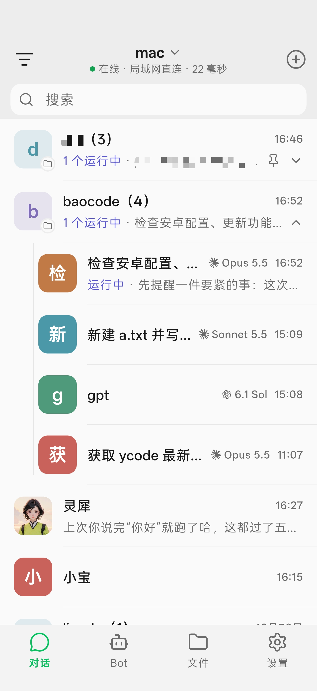
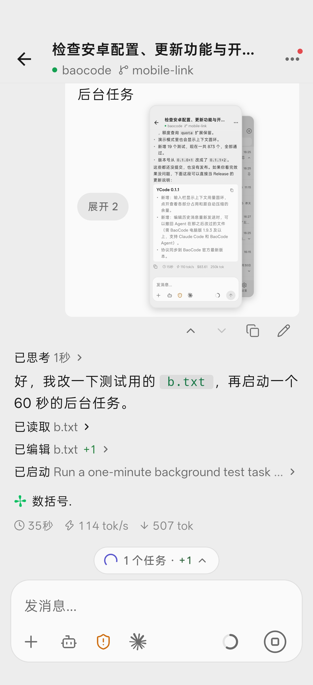

# BaoCodeX

**English** · [简体中文](README_CN.md)

[Android preview releases](https://github.com/juneix/ycode/releases) · [Changelog](CHANGELOG.md) · [YCode upstream](https://github.com/shuishani/ycode)

BaoCodeX is an independent, unofficial Android client for BaoCode desktops, based on the open-source YCode project and built with Flutter. It pairs with your computer over link v2 (iroh/QUIC, Ed25519 and end-to-end encryption), so you can follow and continue desktop conversations from your phone.

The app uses the independent package `juneix.baocodex`. It does not replace YCode or YCode Preview, and does not automatically migrate their pairings or local drafts. Keep the old app installed and pair BaoCodeX separately.

The current source targets **1.0.7**. The screenshots below show the upstream 0.1.1 interface, not the new layout; new captures follow signed cloud builds and device verification.

| Home | Conversation |
| :---: | :---: |
|  |  |

This is not an official BaoCode product and does not represent support from the BaoCode team. Model calls, credentials and task execution stay on the computer. Only connect to computers you trust.

## Install and update

- **Install BaoCode on your computer first**: website <https://baocode.dev>, download <https://baocode.dev/download>. In Settings → Mobile, display a QR code and scan it with BaoCodeX.
- **Install a preview**: use this repository's [pre-releases](https://github.com/juneix/ycode/releases). BaoCodeX targets arm64 devices with Android 7.0 or later; iOS is not currently supported. The app name is BaoCodeX and its package is exactly `juneix.baocodex`, without a preview suffix.
- **Updates**: preview APKs are downloaded manually. Automatic update checks use the repository configured into the build and only its stable releases. Later BaoCodeX updates must keep the package and signing key and increase the version number (for example 1.0.3 → 1.0.4); do not uninstall just to update.
- **Repository renaming**: rename the repository before building the first APK intended for long-term use. GitHub Actions embeds its actual repository into the update source; strict URL checks do not promise automatic adaptation to a later rename.

## Features

- New-conversation home without bottom tabs. Open the 80% workspace sidebar with the menu or a right swipe; open the right-side session drawer (shortcuts plus session actions) with a left swipe or the top-right More button, and project files with the file button. Bots, Files and Settings use normal Back navigation.
- Search and filter workspaces and conversations. Expand or collapse all groups, show five conversations before expanding, display relative times and group locally by project, last update date or status.
- Keep one current conversation per Bot, with a mascot and a greeting using the profile name. Bot management remains available; inapplicable project-chat controls are hidden.
- Time-of-day greetings and refreshed suggestions that only fill the draft. The central workspace button opens the project picker rather than the sidebar.
- Images, camera, file mentions and slash commands in the input menu. Show the selected model name, real context usage and independent send/stop controls; use a native Android text dropdown for permissions and segmented modes.
- Pair by QR code, pasted link or LAN discovery; multiple computers and reconnects. Preserve local drafts, streaming messages, queued and immediate sends, and editing/resending history.
- Markdown, code highlighting, math and offline Mermaid; folded tools and thinking, approvals and questions, plans and subagents.
- File tree, search, preview, source and diffs, with keeping or undoing changes. Directory list/grid controls live in the file toolbar.
- Chinese/English and system/light/dark themes. Context usage and file rewind need desktop support; unsupported capabilities are not estimated or invented.

Existing archive actions are retained. Archive browsing/restoring and creation-time sorting are not added in 1.0.3; date grouping uses the last update date.

## Development and verification

APK analysis, tests, building and signing run in GitHub Actions. The runner uses the configured exact Flutter 3.47.x version, Dart compatible with `^3.13.4`, JDK 21 and Rust 1.97.1. No local Android SDK, Gradle, signing tools or emulator installation is required for this workflow.

The cloud checks run:

```sh
flutter analyze --no-pub
flutter test --no-pub
```

The Android workflow also publishes a pre-release; triggering it is a release operation, not a checks-only run. Packaging and signing details are in [docs/release-android.md](docs/release-android.md). Real APK/device/computer checks are needed for native menus and external behavior; unit fixtures are not substitutes.

## Origin and license

Based on YCode, Copyright (C) 2026 shuishan. The project as a whole remains **GPL-3.0-only**; see [LICENSE](LICENSE).

- `vendor/bao_link` and the files copied or adapted from BaoCode retain GPL-3.0-only and their authors' copyright. `vendor/bao_iroh` and `vendor/bao_editor` retain their MIT and third-party licenses.
- Icons use Lucide 1.66.0, Remix Icon 4.8.0, theSVG, Simple Icons and Material Icon Theme. The Bot mascot is an authorized project asset. See [THIRD_PARTY_NOTICES.md](THIRD_PARTY_NOTICES.md); the app also lists licenses under Settings → About BaoCodeX → Open-source licenses.
- Layout and interactions are designed independently. Protocol origins and upstream synchronization are documented in [docs/upstream-sync.md](docs/upstream-sync.md).
- BaoCode and model-provider names and logos belong to their respective owners.

## Contributing

Issues and pull requests are welcome; see [CONTRIBUTING.md](CONTRIBUTING.md). Report security issues privately as described in [SECURITY.md](SECURITY.md).

Do not commit or publish model credentials, pairing details, real chat logs, signing keys, signing passwords or build artifacts.
