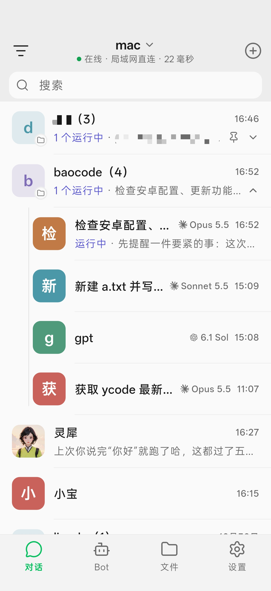
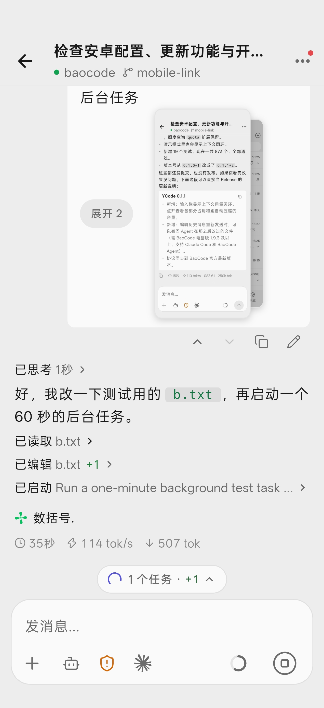

# BaoCodeX

**English** · [简体中文](README_CN.md)

[Releases](https://github.com/juneix/baocodex/releases) · [Changelog](CHANGELOG.md)

BaoCodeX is an Android client for BaoCode desktops, forked from the open-source YCode and kept for my own daily use. It pairs with the computer over link v2 (iroh/QUIC, Ed25519, end-to-end encryption), so I can see what the desktop is working on and carry the conversation on from the phone.

It does not mirror upstream or chase feature parity. What is its own:

- **Live activity**: the status chip and dynamic island show approve / answer / running / done, with context usage and a stop button — only when someone needs to look.
- **A home of its own**: a new-conversation home, a right-swipe sidebar with two-level type, SSH / WSL badges, four-colour status dots, and filtering by source, status and pin.
- **A steadier link**: probes on their own request stream, immediate failure on write errors, late replies no longer read as a live connection, large messages parsed off the main isolate.

Conversations, Bots, files, approvals, plans, subagents and Markdown / math / Mermaid follow upstream and stay in sync.

The app uses its own package, `juneix.baocodex`; it does not replace YCode or migrate its pairings. It is not an official BaoCode product, and only connects to computers you trust.

## Screenshots

These still show an early version, not the current layout.

| Home | Conversation |
| :---: | :---: |
|  |  |

## Install and update

- **Install BaoCode on the computer first**: <https://baocode.dev/download>. In Settings → Mobile, show the QR code and scan it with BaoCodeX.
- **Download**: [Releases](https://github.com/juneix/baocodex/releases). Android 7.0 and later, arm64; iOS is not supported.
- **Updates**: automatic checks only look at this repository's stable releases; preview APKs are downloaded manually. Keep the same package and signing key and raise the version number; do not uninstall to update.

## Build

Analysis, tests, building and signing run in GitHub Actions on push, with no local Android SDK. The checks are `flutter analyze --no-pub` and `flutter test --no-pub`; packaging and signing are in [docs/release-android.md](docs/release-android.md).

## Relationship to upstream

BaoCodeX is forked from [YCode](https://github.com/shuishani/ycode). Upstream changes are taken **layer by layer**: link, state and rendering fixes only, while product choices stay this repository's. The aligned commit and every choice are recorded in [docs/upstream-sync.md](docs/upstream-sync.md).

## License

Based on YCode, Copyright (C) 2026 shuishan; released under **GPL-3.0-only**. Files from BaoCode stay GPL-3.0-only; `vendor/bao_iroh` and `vendor/bao_editor` keep their MIT licenses. Icons come from Lucide, Remix Icon 4.8.0, theSVG, Simple Icons and Material Icon Theme — see [THIRD_PARTY_NOTICES.md](THIRD_PARTY_NOTICES.md). The interface is designed independently; BaoCode and the providers' names belong to their owners.
