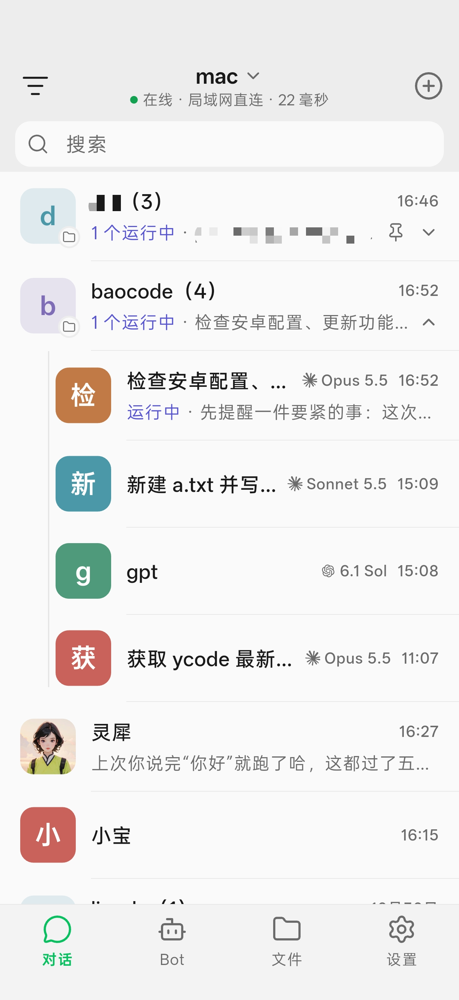
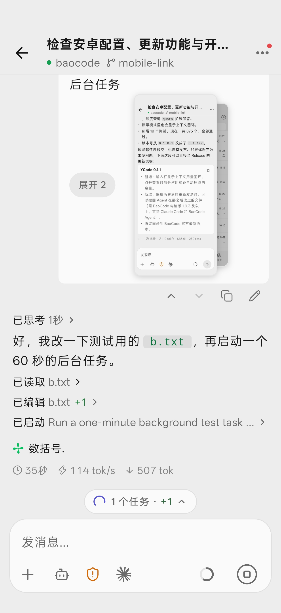

# BaoCodeX

[English](README.md) · **简体中文**

[预览版下载](https://github.com/juneix/baocodex/releases) · [更新日志](CHANGELOG_CN.md)

BaoCodeX 是一个 BaoCode 电脑版的 Android 客户端，从开源项目 YCode 分叉而来，按自己的日常使用习惯维护。通过 link v2（iroh/QUIC、Ed25519、端到端加密）配对电脑，一眼看到电脑上的任务在干什么，然后顺手接着聊。

它不复刻上游，也不追求功能对齐。属于它自己的是这些：

- **状态栏实时活动**：胶囊和灵动岛显示「待批准 / 待回答 / 运行中 / 已完成」，带上下文用量和「停止」按钮，只在需要人看一眼的时候出现。
- **自己的一套首页**：无底栏的新对话首页，右滑拉出侧栏；项目和对话两级字号、SSH / WSL 徽章、四色状态圆点，还能按来源、状态、置顶筛选。
- **更稳的连接层**：探测走独立请求流，写失败立即返回，迟到的回复不再误判成活连接，大消息移出主 isolate 解析。

对话、Bot、文件、审批、计划、子代理、Markdown / 公式 / Mermaid 等功能与上游同源，会跟着上游更新。

应用使用独立包名 `juneix.baocodex`，不覆盖 YCode，也不会迁移它的配对。它不是 BaoCode 官方产品，请只连接自己信任的电脑。

## 截图

下方截图仍是早期版本，不代表现在的布局。

| 首页 | 对话 |
| :---: | :---: |
|  |  |

## 安装与更新

- **先在电脑上装 BaoCode**：<https://baocode.dev/download>。在「设置 → 手机」显示二维码，用 BaoCodeX 扫码配对。
- **下载**：从 [Releases](https://github.com/juneix/baocodex/releases) 下载，支持 Android 7.0 及以上的 arm64 设备，暂不支持 iOS。
- **更新**：自动检查只查本仓库的稳定版本，预览版 APK 手动下载。保持同一包名、同一签名并递增版本号，不要为了更新而卸载。

## 构建

分析、测试、构建与签名都在 GitHub Actions 上由提交触发，本机不需要 Android SDK。检查项为 `flutter analyze --no-pub` 和 `flutter test --no-pub`；打包与签名见 [docs/release-android.md](docs/release-android.md)。

## 与上游 YCode 的关系

BaoCodeX 从 [YCode](https://github.com/shuishani/ycode) 分叉而来。跟进上游的原则是**分层吸收**：只取连接层、状态层、渲染层的修补，产品层的取舍保留本仓库的做法。已对齐的提交和每次取舍都记在 [docs/upstream-sync.md](docs/upstream-sync.md)。

## 许可

基于 YCode，Copyright (C) 2026 shuishan，整体按 **GPL-3.0-only** 发布。来自 BaoCode 的文件保留 GPL-3.0-only；`vendor/bao_iroh`、`vendor/bao_editor` 保留 MIT 许可。图标来自 Lucide、Remix Icon 4.8.0、theSVG、Simple Icons 和 Material Icon Theme，详见 [THIRD_PARTY_NOTICES.md](THIRD_PARTY_NOTICES.md)。界面独立设计；BaoCode 及各模型服务商的名称归各自权利人所有。
