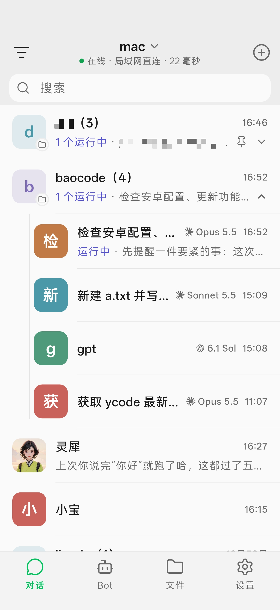
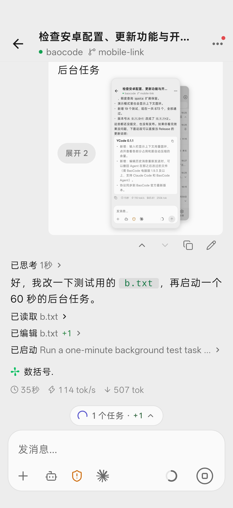

# BaoCodeX

[English](README.md) · **简体中文**

[Android 预览版发布](https://github.com/juneix/ycode/releases) · [更新日志](CHANGELOG_CN.md) · [YCode 上游](https://github.com/shuishani/ycode)

BaoCodeX 是基于开源 YCode、使用 Flutter 开发的 BaoCode 电脑版独立非官方 Android 客户端。通过 link v2（iroh/QUIC、Ed25519、端到端加密）配对电脑，在手机上查看和继续电脑上的对话。

应用使用独立包名 `juneix.baocodex`，不覆盖 YCode 或 YCode Preview，也不会自动迁移它们的配对和本地草稿。保留旧应用，并为 BaoCodeX 单独重新配对。

当前源码目标版本为 **1.0.4**。下方截图是上游 0.1.1 的旧界面，不代表新布局；新截图随签名云构建与真机验收补充。

| 首页 | 对话 |
| :---: | :---: |
|  |  |

本项目不是 BaoCode 官方产品，不代表官方提供支持。模型调用、凭据与任务执行仍由电脑端管理。请只连接自己信任的电脑。

## 安装与更新

- **先在电脑上安装 BaoCode**：官网 <https://baocode.dev>，下载 <https://baocode.dev/download>。在「设置 → 手机」显示二维码，用 BaoCodeX 扫码配对。
- **安装预览版**：使用本仓库的 [pre-release](https://github.com/juneix/ycode/releases)。BaoCodeX 面向 Android 7.0 及以上的 arm64 设备，暂不支持 iOS。显示名为 BaoCodeX，包名精确为 `juneix.baocodex`，不附加预览后缀。
- **更新**：预览 APK 暂时手动下载。自动检查使用构建时配置的仓库，只查询稳定版本。后续 BaoCodeX 更新保持同一包名、同一签名和更高的版本号（如 1.0.3 → 1.0.4），不要为了更新而卸载。
- **仓库改名**：建议在首个长期使用的 APK 云构建前完成改名。GitHub Actions 会把实际仓库写入更新源；严格 URL 校验不保证自动适配之后的改名。

## 功能

- 无底部栏的新对话首页；菜单或右滑打开 80% 工作区侧栏，左滑或右上角「更多」打开右侧会话抽屉（快捷入口 + 会话操作），文件按钮进入项目文件。Bot、文件、设置使用正常返回导航。
- 搜索、筛选工作区与会话；全部展开/收起、默认五条与显示更多、相对时间，以及按项目、最近更新日期、状态的本地分组。
- 每个 Bot 保留一条当前会话，提供吉祥物和资料名称问候；保留 Bot 管理，隐藏不适用的项目聊天入口。
- 时间段问候和可“换一换”的提示词，点击只填草稿；中央工作区按钮打开项目选择弹窗，不等同于侧栏。
- 图片、拍照、@ 文件、斜杠命令集中到输入菜单；显示模型名称、真实上下文用量和独立发送/停止，权限使用 Android 原生纯文字下拉，模式使用分段切换。
- 扫码、粘贴或局域网发现配对，多台电脑与断线重连；保留本地草稿、流式消息、排队与立即插入、编辑历史消息重发。
- Markdown、代码高亮、数学公式、离线 Mermaid；工具与思考折叠、审批与提问、计划和子代理。
- 文件树、搜索、预览、源码、差异，以及保留/撤回改动；目录列表/网格切换位于文件标题栏。
- 中英文与系统/浅色/深色主题；上下文用量和文件撤回需要电脑端支持，不估算或伪造不支持的能力。

保留既有归档动作。1.0.3 不新增归档浏览/恢复或创建时间排序；日期分组使用最近更新日期。

## 开发与验证

APK 的分析、测试、构建与签名在 GitHub Actions 执行。Runner 使用配置的精确 Flutter 3.47.x、满足 `^3.13.4` 的 Dart、JDK 21 和 Rust 1.97.1；该流程不要求在本机安装 Android SDK、Gradle、签名工具或模拟器。

云端检查执行：

```sh
flutter analyze --no-pub
flutter test --no-pub
```

Android 工作流还会发布 pre-release，触发整条属于发布操作，不是仅检查。打包与签名说明见 [docs/release-android.md](docs/release-android.md)。原生菜单与外部行为必须用真实 APK、真机和电脑验收；单元测试的合成数据不能代替。

## 来源与许可

基于 YCode，Copyright (C) 2026 shuishan。整体项目继续按 **GPL-3.0-only** 发布，见 [LICENSE](LICENSE)。

- `vendor/bao_link` 以及来自 BaoCode 的复制/改编文件保留 GPL-3.0-only 与原作者版权；`vendor/bao_iroh`、`vendor/bao_editor` 保留 MIT 和各自第三方许可。
- 图标使用 Lucide 1.66.0、Remix Icon 4.8.0、theSVG、Simple Icons 和 Material Icon Theme；Bot 吉祥物为授权项目素材。详见 [THIRD_PARTY_NOTICES.md](THIRD_PARTY_NOTICES.md)，应用内「设置 → 关于 BaoCodeX → 开源许可」也会列出。
- 布局与交互独立设计；协议来源及上游同步见 [docs/upstream-sync.md](docs/upstream-sync.md)。
- BaoCode 及模型服务商的名称、标识归各自权利人所有。

## 参与贡献

欢迎提交 Issue 和 Pull Request，见 [CONTRIBUTING.md](CONTRIBUTING.md)。安全问题请按 [SECURITY.md](SECURITY.md) 私下报告。

不提交或公开模型凭据、配对信息、真实聊天记录、签名密钥、签名口令及构建产物。
